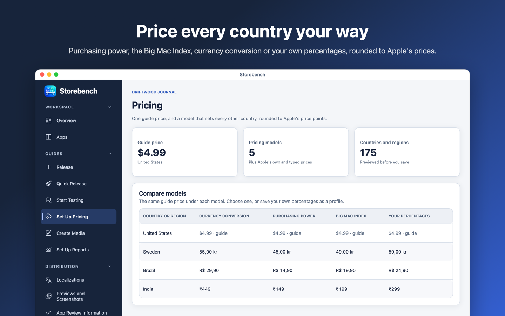
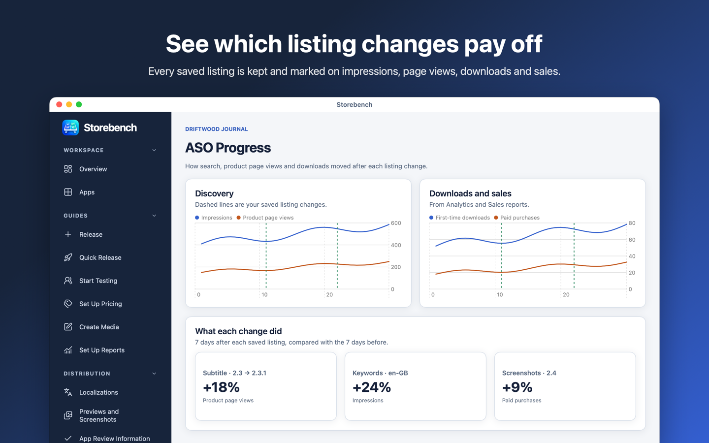
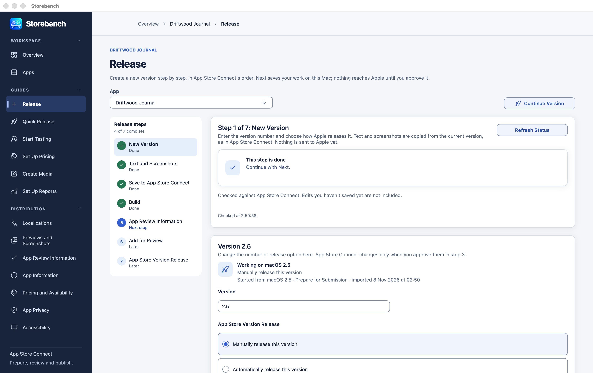
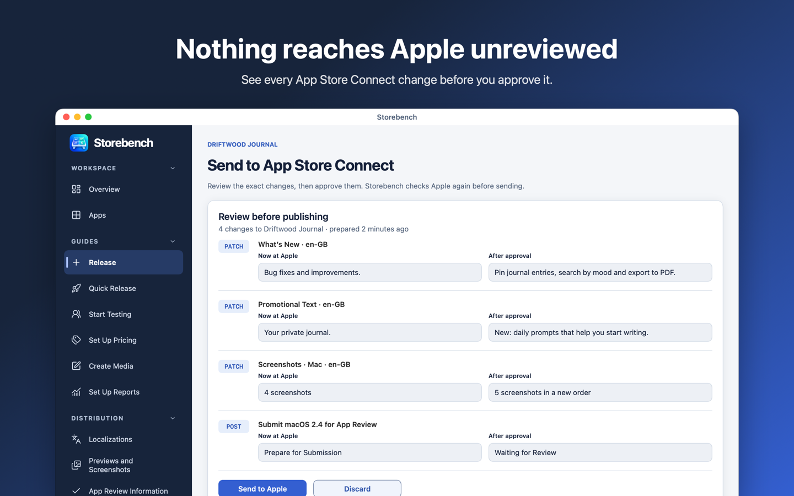
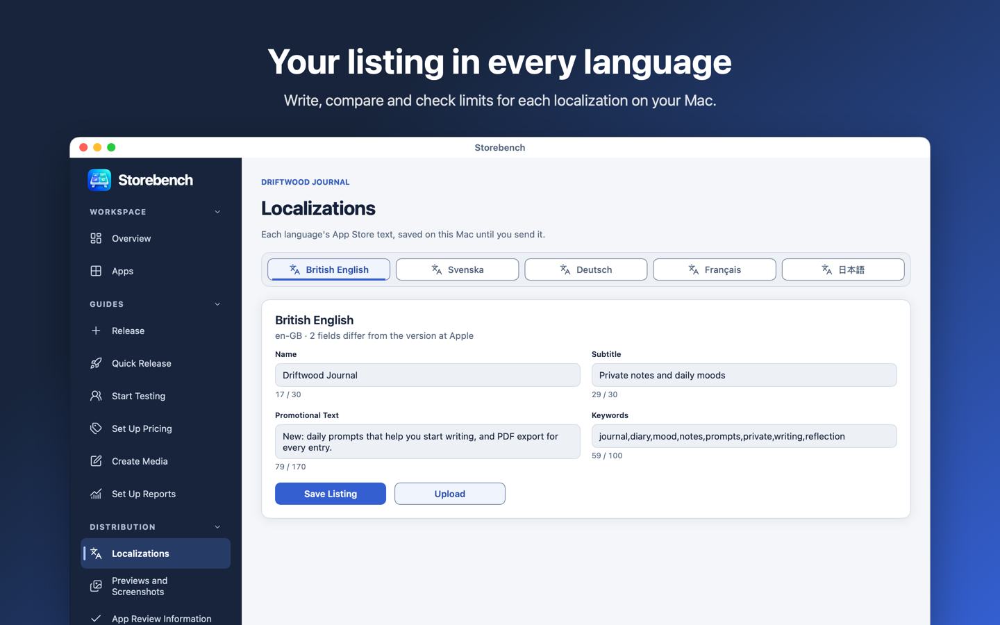
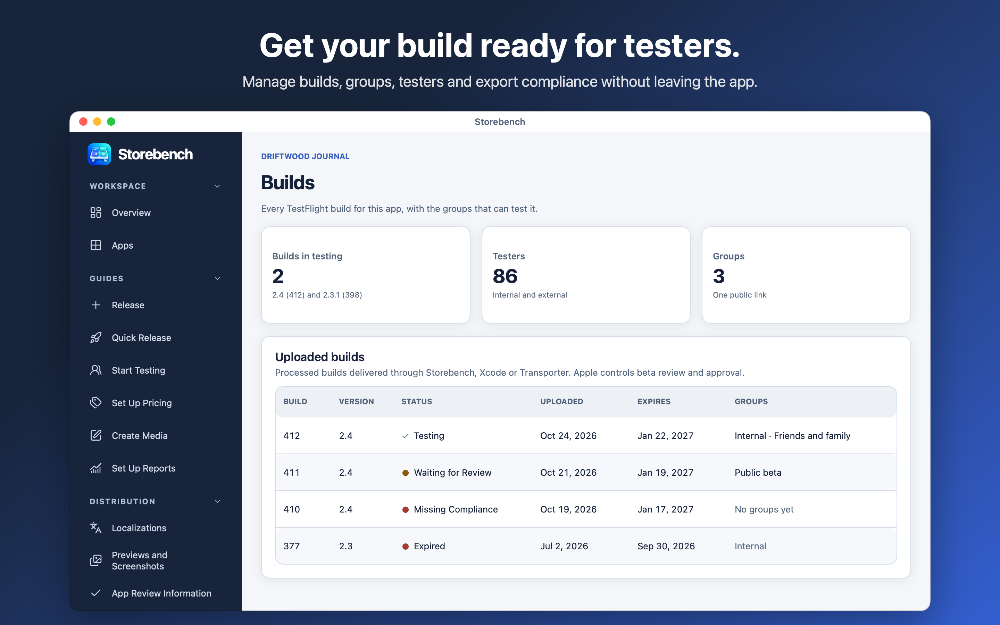
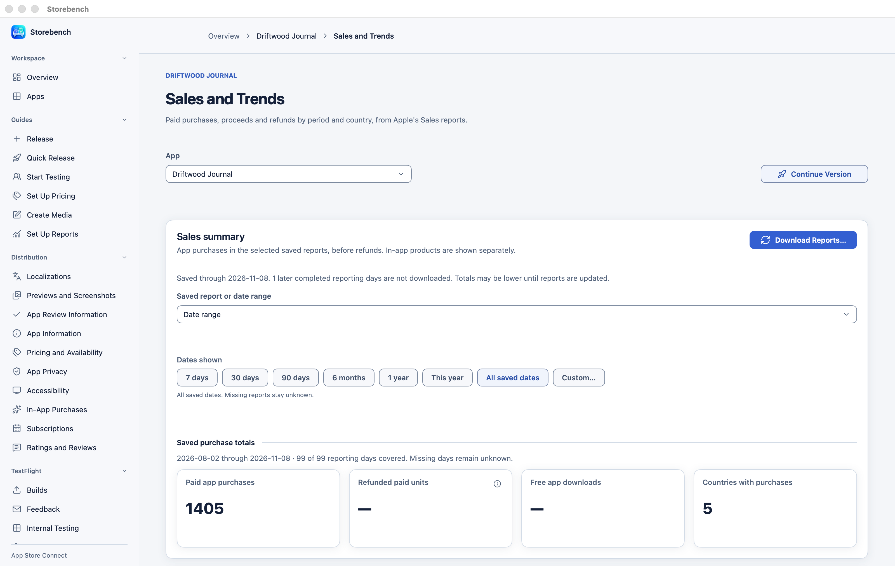

# Storebench

Storebench is a Mac app for managing apps in App Store Connect. Prepare releases, edit localized listings and media, manage pricing and TestFlight, and read reports across several apps in one encrypted local workspace.

Edits are saved locally. Before sending changes to App Store Connect, Storebench shows a concrete review for the selected account and app, asks for approval, and checks that the reviewed information still matches.

## Screenshots

The screenshots show a fictional app with sample data.

### Pricing models

Set one guide price and let a model price every other country: World Bank purchasing power, the Big Mac Index, currency conversion, the same amount everywhere, or your own percentage per country. Compare the models side by side, keep a choice as a saved profile, or use Apple's comparable prices or typed prices instead. Every price is rounded to one of Apple's price points and reviewed before anything is sent.



### Your ASO history and what it did

Storebench keeps every listing you import, so your full ASO history stays on your Mac. ASO Progress marks each saved change on daily impressions, product page views, first-time downloads and paid purchases, and compares the days after a change with the same number of days before. That shows whether a new subtitle, keywords or screenshots made a difference.



### Releases, reviews and the rest











## Requirements

Storebench runs on macOS 14 or later, on Apple silicon and Intel Macs. Connecting an app requires an App Store Connect API key with access to that app. Available actions depend on the account's permissions and the app's current state at Apple.

## Getting started

Choose **Use Keychain** or **Use Password** when Storebench first opens. Both options encrypt saved data and media. Password storage requires your Storebench password to unlock the workspace; keep it safe, because it cannot be recovered.

Connect your API key during setup or in **Settings → Apple accounts**. Choose the original `.p8` file and supply its Key ID if Storebench cannot read it from the filename. Team keys also need their Issuer ID. You can connect several accounts, refresh their app lists and reconnect a key without removing saved app history. **Skip for now** opens an empty workspace so you can connect later.

Use **Overview** or **Apps** to download app material and reports. The sidebar opens each app's editing, release, TestFlight and reporting sections. **Help** contains searchable guidance for setup, permissions and common problems.

## Releases and localizations

Prepare a version from existing app material, copy an earlier version or start with an empty local plan. Edit listing text across languages, select a build and check what is still needed before submitting the version.

**Localizations** keeps each language's text, character budgets and comparison with imported values together. Text reuse previews changes before applying them locally. Copied wording retains its source so a later source change can be reviewed without overwriting the destination.

Local drafts and release plans remain separate from what Apple currently has. **History** preserves imported material and saved revisions; **Change journal** records before-and-after values and lets you add local notes. A detected change does not establish when it became public on the App Store.

## Screenshots, app previews and Asset Library

Add screenshots and app previews to a version and language, change their order and review the saved selection. Image editing supports cropping, rotation and resizing while retaining the original.

**Asset Library** keeps encrypted local originals and reads assets already at Apple. Processed assets can be reused across compatible placements. Uploads, placement changes and asset deletion each require an approved review.

**Create Media** builds screenshot cards with text, backgrounds and reusable styles. Save rendered cards to Asset Library or export PNG files, then select them for a release.

## Pricing

Manage the app's download price separately from subscriptions and in-app purchases. Read current and scheduled prices, prepare changes by country or region, and compare proposed prices before sending them.

Price strategies include Apple's comparable prices, currency conversion, purchasing-power models, the Big Mac Index, saved profiles and manually entered country prices. Storebench matches proposed amounts to the product's available Apple price points and identifies missing data. Protected app prices are kept out of model and country-draft changes.

Shared profiles and local pricing drafts detect conflicting saves. Reading newer saved values leaves your edits in place until you explicitly choose which baseline to use. Price changes and offers go through the same approval process as other App Store Connect changes.

## App information, App Privacy and App Review

Edit supported app information, age-rating answers, accessibility declarations, availability, export compliance and App Review information. Storebench checks the selected app and the information required for each change.

**App Privacy answers** and **Tax Category** use a separate Apple ID sign-in because they are not available through the API-key connection. Sign-in asks for the Apple ID, password and any required two-factor code. Saving the password for a later sign-in is optional. **Sign Out** in the Apple ID form removes the saved Apple ID session.

## TestFlight

Read builds, processing states, export compliance, groups, testers, test information, feedback and metrics. **Start Testing** brings the setup into a guided sequence. Changes to TestFlight settings, group access, tester assignments and Beta App Review submissions require approval before being sent.

## Reports and sync

Read **Sales and Trends**, **Analytics**, **Financial Reports** and **Ratings and Reviews**. Sales and Finance can use the API connection or a separately configured Reporter token. Reporter downloads use HTTPS directly.

Sync downloads data and keeps saved drafts. It shows incomplete sources separately so a partial download is not presented as a complete sync. Missing reports and unverified values remain unknown. An explicit, validated day without sales is recorded separately from a report Apple has not delivered.

Sales analysis shows report coverage, original currencies, trends and country totals. Analytics and ASO views help compare reported activity with recorded changes while retaining coverage and source information. Generating Analytics reports at Apple requires an approved review. Financial downloads have a separate local review before replacing saved reports.

## Keyword ideas

Keep a local notebook of keyword ideas by language and territory, with evidence notes, filters and bulk changes. Preview selected ideas against a listing's current keywords and UTF-8 byte budget before applying them to the unsaved text. Notebook imports and exports support CSV and JSON.

## Reviewing changes at Apple

**App Store changes** shows the exact operations prepared for one account and app. Preparing a review does not send those operations. Approval applies once to that review, and Storebench reads Apple again to check that the reviewed state is still current.

A changed draft, changed Apple state or expired review requires a new review. If publishing is interrupted, some earlier operations may already have reached Apple. Storebench records the result and requires a new review instead of replaying the interrupted run.

## Storage and backups

Saved metadata, drafts, revisions and reports live in an encrypted local SQLCipher database. Media files are encrypted separately. Credentials use the storage provider selected for the workspace: macOS Keychain or a password-encrypted credential file. Security settings also offer Mac authentication and protected Keychain access.

Use a private local disk for the workspace. A network share or file-synchronization folder is not supported for live workspace data. Saved material survives restarts; unsaved form edits still need to be saved.

Encrypted backups include saved workspace data and media and require a restore passphrase. Automatic backups use a folder you choose. Keep the passphrase separately from the backup and reconnect Apple credentials when restoring on another Mac. The workspace itself is not a backup.

CSV and JSON imports preview their local changes before saving. Exports can contain private app information and should be stored accordingly. Importing local material does not publish it to Apple.

## Settings and navigation

Settings cover accounts, reporting connections, storage protection, backups, appearance, editing, keyboard shortcuts and performance. The Performance setting controls cache budgets and how long downloaded reads are reused. Manual refresh and publishing invalidate affected reads; publishing approval always checks fresh information.

Unsaved editors ask you to save, discard or keep editing before leaving. Back and Forward retain navigation history. Keyboard shortcuts can be changed in Settings, and Command–Comma opens Settings.

## Build from source

Building requires Xcode or the Xcode Command Line Tools with Swift 6. Resolve the pinned SQLCipher dependency, then build the app and unsigned installer:

```bash
swift package resolve --package-path macos --disable-keychain --disable-netrc
scripts/package-mac.sh
```

The public packaging command builds a universal app with placeholder version metadata and ad-hoc signatures for local execution. The installer is unsigned. Packaging does not start, install or upload the app.

## Tests

Run tests through the isolated runner:

```bash
scripts/test-swift.sh unit
```

The runner uses synthetic data in a fresh owned workspace. Its macOS sandbox blocks networking, private home data and writes outside that run. Tests do not launch the app, access real Keychain entries or use real Apple accounts. The pinned dependency must already be available locally.

## License

Storebench is source-available. Personal and other non-commercial use is free. Business use requires an active subscription for each person who uses Storebench, available through the Mac App Store, or another commercial license from the licensor. Business use ends with the subscription. See [LICENSE](LICENSE).
