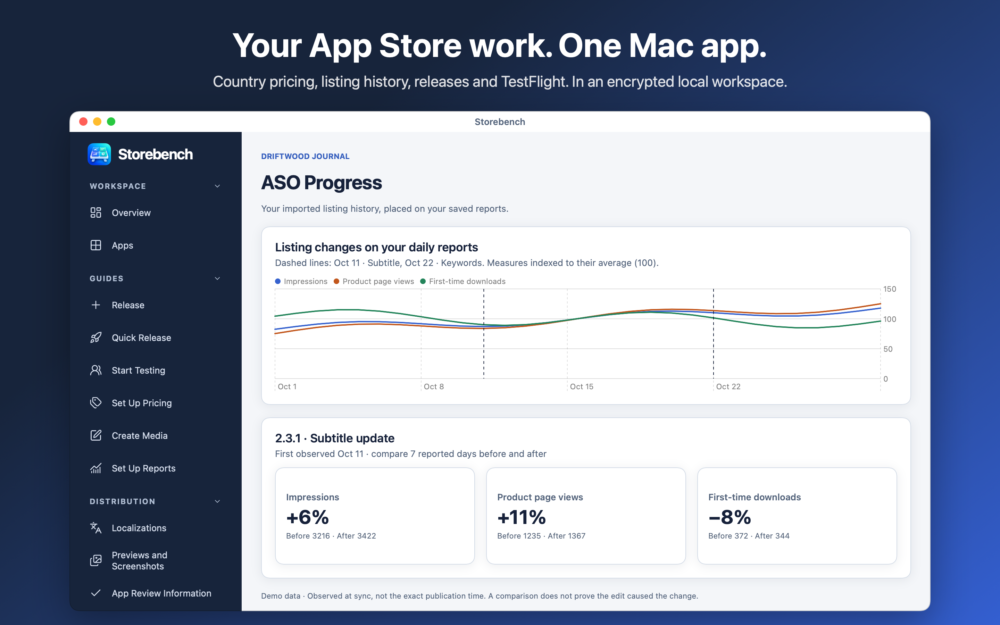
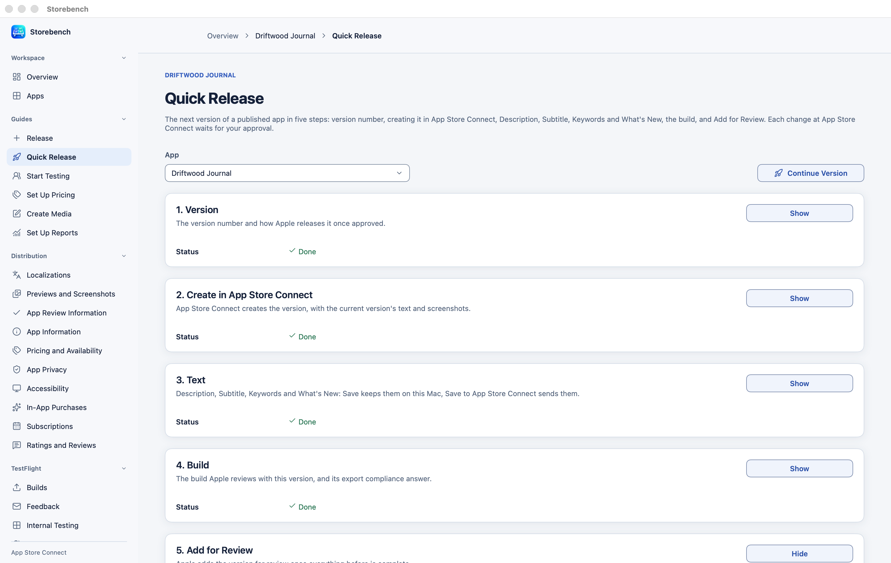
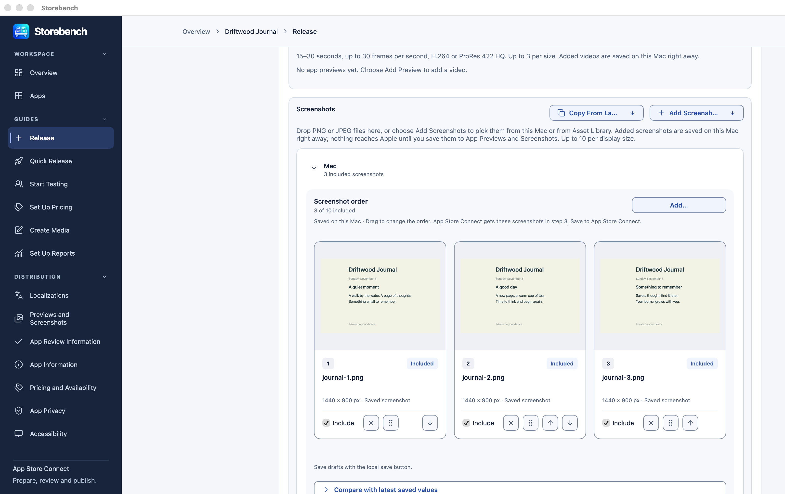
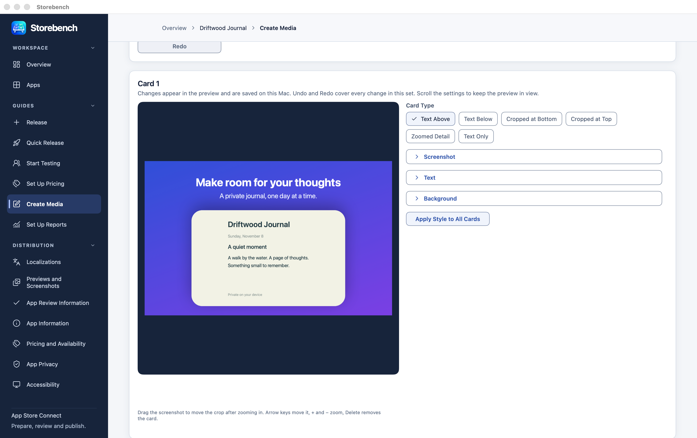
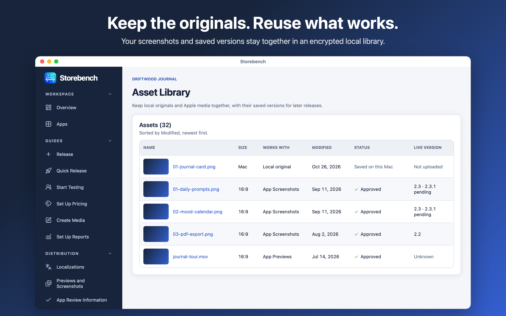

# Storebench



Storebench is a native Mac app for developers managing several apps in App Store Connect. Set country prices from one guide price, keep the listings and reports you import, and see how your numbers changed around each listing update. Prepare releases, manage TestFlight and make screenshot cards in the same encrypted local workspace.

Edits stay on your Mac until you prepare a review and approve sending them to Apple. A local save, an upload and a public release are separate steps.

[See all screenshots](#screenshots).

## Set country prices without working through them one by one

A currency conversion does not tell you what a price means to someone in another country. Start with a guide country and price, then compare different ways to price the other countries before choosing one:

- **World Bank purchasing power:** adjust the guide price for differences in local price levels.
- **Big Mac Index:** scale prices using the local price of a Big Mac.
- **Currency conversion:** keep approximately the same value in your guide currency.
- **Same for all:** use the same number in each currency, such as 4.99, without converting it.
- **Your country percentages:** adjust converted prices by your own percentage for each country.
- **Your own index:** import the values you want to price against from a CSV file.

Build a recipe when one model is not enough. For example, mix 70% purchasing power with 30% currency conversion, adjust particular countries, and set a lowest and highest share of the guide price. Save the recipe as a profile to reuse across your apps. You can also use Apple's comparable prices or type country prices, including importing them from CSV.

Compare the resulting country prices side by side. Storebench matches them to the product's available Apple price points, identifies missing data, and shows the proposed changes before you approve anything being sent.

[See the pricing comparison](#pricing-models).

## Keep your listing history and see what happened after a change

You changed a subtitle or replaced some keywords. Which wording was there before, when was the new listing first seen, and did impressions, page views or downloads move afterwards?

Storebench saves each listing revision you import for each app, together with downloaded reports, in your encrypted workspace. Later syncs add new snapshots without replacing the earlier ones. You can go back to the saved text and screenshots, compare versions, and read the history on your Mac.

In **ASO Progress**, choose a language and the listing fields you want to compare. Overlay up to four report measures on the same graph: impressions, App Store product page views, Get taps, first-time downloads or purchases, including search-specific measures where available. Use the indexed scale to compare lines with different sizes. Markers show where a changed released listing was first observed at a sync.

Select a change to read the old and new text and compare the same number of days before and after it. For example, compare seven days around a keyword update, then inspect the next update on the same timeline. This helps you decide what to try next from your own saved history.

The comparison shows observed changes, not proof that an ASO edit caused them. Other updates in the same window are identified. Missing reports stay missing, and the observed date is not a verified publication time. History builds from the listings and reports you import; text from before your first saved snapshot cannot be reconstructed.

[See the ASO timeline and before/after comparison](#aso-history).

## Follow a full release from setup to App Review

Use **Version setup**, the full release guide, for a new app, a new platform or a release that needs the full setup. Work through the version, text and screenshots, build, export compliance, App Review Information and submission in order. The guide shows what Apple still needs, with the relevant editor or action beside the problem, instead of leaving you to find it across separate pages.

App information, age rating, availability, accessibility and other required declarations are surfaced before submission. Available actions depend on your account and Apple's current state; App Privacy and Tax Category use a separate Apple ID sign-in. Each change at Apple still has its own review and approval.

For an existing app's next version, **Quick Release** keeps the essentials together: choose the version, create it in App Store Connect, update the text, select the build and its export compliance answer, then Add for Review. It uses the same version plan and drafts as Version setup. If Apple needs something outside those steps, continue in the full guide without starting over.

[See Release and Quick Release](#release-and-quick-release).

## Prepare screenshots without moving between tools

Add screenshots from files or Asset Library in **Version setup → Text and Screenshots**. Check the language and display size, drag screenshots into the order you want, and save the layout. Upload prepares a review of what will change at Apple.

Use **Create Media** to turn your app screenshots into App Store cards with titles, text, backgrounds and reusable styles. Save the finished PNGs to **Asset Library**, choose them for a release, and arrange them with your other screenshots. Asset Library keeps encrypted local originals and their history so you can reuse earlier material.

[See screenshot ordering and card creation](#screenshots-and-card-creation), or [see Asset Library](#asset-library).

## Requirements

Storebench runs on macOS 14 or later, on Apple silicon and Intel Macs. Connecting an app requires an App Store Connect API key with access to that app. Available actions depend on the account's permissions and the app's current state at Apple.

## Getting started

Choose **Use Keychain** or **Use Password** when Storebench first opens. Both options encrypt saved data and media. Password storage requires your Storebench password to unlock the workspace; keep it safe, because it cannot be recovered.

Connect your API key during setup or in **Settings → Apple accounts**. Choose the original `.p8` file and supply its Key ID if Storebench cannot read it from the filename. Team keys also need their Issuer ID. You can connect several accounts, refresh their app lists and reconnect a key without removing saved app history. **Skip for now** opens an empty workspace so you can connect later.

Use **Overview** or **Apps** to download app material and reports. The sidebar opens each app's editing, release, TestFlight and reporting sections. **Help** contains searchable guidance for setup, permissions and common problems.

## Releases and localizations

Prepare a version from existing app material, copy an earlier version or start with an empty local plan. Edit listing text across languages, select a build and check what is still needed before submitting the version.

**Localizations** keeps each language's text, character budgets and comparison with imported values together. Text reuse previews changes before applying them locally. Copied wording retains its source so a later source change can be reviewed without overwriting the destination.

Local drafts and release plans remain separate from what Apple currently has. **History** preserves imported material and saved revisions; **Change journal** records before-and-after values and lets you add local notes. A detected change does not establish when it became public on the App Store.

## Screenshots, app previews and Asset Library

Add screenshots and app previews to a version and language, change their order and review the saved selection. Image editing supports cropping, rotation and resizing while retaining the original.

**Asset Library** keeps encrypted local originals and reads assets already at Apple. Processed assets can be reused across compatible placements. Uploads, placement changes and asset deletion each require an approved review.

**Create Media** builds screenshot cards with text, backgrounds and reusable styles. Save rendered cards to Asset Library or export PNG files, then select them for a release.

## Pricing

Manage the app's download price separately from subscriptions and in-app purchases. Read current and scheduled prices, prepare changes by country or region, and compare proposed prices before sending them.

Price strategies include Apple's comparable prices, currency conversion, purchasing-power models, the Big Mac Index, saved profiles and manually entered country prices. Apple's comparable prices follow the base country or region you choose; any of Apple's countries or regions can be the base. Saved profiles are recipes that can mix two methods, adjust countries by percentage, keep prices within a lowest and highest price, and use your own index values.

Country prices, country percentages and your own index can be imported from CSV files that use Apple's three-letter territory codes. Prices use the columns of Storebench's own price export, so an exported file can be edited and read back. Copy CSV Format copies each format with example rows, and the pricing help describes every column. Importing only fills in the editor; nothing is saved or sent. Storebench matches proposed amounts to the product's available Apple price points and identifies missing data. Protected app prices are kept out of model and country-draft changes.

Shared profiles and local pricing drafts detect conflicting saves. Reading newer saved values leaves your edits in place until you explicitly choose which baseline to use. Price changes and offers go through the same approval process as other App Store Connect changes.

## App information, App Privacy and App Review

Edit supported app information, age-rating answers, accessibility declarations, availability, export compliance and App Review information. Storebench checks the selected app and the information required for each change.

**App Privacy answers** and **Tax Category** use a separate Apple ID sign-in because they are not available through the API-key connection. Sign-in asks for the Apple ID, password and any required two-factor code. Saving the password for a later sign-in is optional. **Sign Out** in the Apple ID form removes the saved Apple ID session.

## TestFlight

Keep beta testing with the app's release work. Read builds and processing states, handle export compliance, manage internal and external groups and testers, edit test information, and inspect feedback and metrics. **Start Testing** walks through the setup in order, including what is still needed before a build can reach testers.

Changes to TestFlight settings, group access, tester assignments and Beta App Review submissions are reviewed before being sent. Apple still controls build processing and beta review.

[See TestFlight builds and groups](#testflight-builds-and-groups).

## Reports and sync

Read **Sales and Trends**, **Analytics**, **Financial Reports** and **Ratings and Reviews**. Sales and Finance can use the API connection or a separately configured Reporter token. Reporter downloads use HTTPS directly.

Sync downloads data and keeps saved drafts. It shows incomplete sources separately so a partial download is not presented as a complete sync. Missing reports and unverified values remain unknown. An explicit, validated day without sales is recorded separately from a report Apple has not delivered.

Sales analysis shows report coverage, original currencies, trends and country totals. Analytics and ASO views help compare reported activity with recorded changes while retaining coverage and source information. Generating Analytics reports at Apple requires an approved review. Financial downloads have a separate local review before replacing saved reports.

## Keyword ideas

Keep a local notebook of keyword ideas by language and territory, with evidence notes, filters and bulk changes. Preview selected ideas against a listing's current keywords and UTF-8 byte budget before applying them to the unsaved text. Notebook imports and exports support CSV and JSON.

## Reviewing changes at Apple

**App Store changes** shows the exact operations prepared for one account and app. Preparing a review does not send those operations. Approval applies once to that review, and Storebench reads Apple again to check that the reviewed state is still current.

A changed draft, changed Apple state or expired review requires a new review. If publishing is interrupted, some earlier operations may already have reached Apple. Storebench records the result and requires a new review instead of replaying the interrupted run.

## Storage and backups

Saved metadata, drafts, revisions and reports live in an encrypted local SQLCipher database. Media files are encrypted separately. Credentials use the storage provider selected for the workspace: macOS Keychain or a password-encrypted credential file. Security settings also offer Mac authentication and protected Keychain access.

Use a private local disk for the workspace. A network share or file-synchronization folder is not supported for live workspace data. Saved material survives restarts; unsaved form edits still need to be saved.

Encrypted backups include saved workspace data and media and require a restore passphrase. Automatic backups use a folder you choose. Keep the passphrase separately from the backup and reconnect Apple credentials when restoring on another Mac. The workspace itself is not a backup.

CSV and JSON imports preview their local changes before saving. Exports can contain private app information and should be stored accordingly. Importing local material does not publish it to Apple.

## Settings and navigation

Settings cover accounts, reporting connections, storage protection, backups, appearance, editing, keyboard shortcuts and performance. The Performance setting controls cache budgets and how long downloaded reads are reused. Manual refresh and publishing invalidate affected reads; publishing approval always checks fresh information.

Unsaved editors ask you to save, discard or keep editing before leaving. Back and Forward retain navigation history. Keyboard shortcuts can be changed in Settings, and Command–Comma opens Settings.

## Build from source

Building requires Xcode or the Xcode Command Line Tools with Swift 6. Resolve the pinned SQLCipher dependency, then build the app and unsigned installer:

```bash
swift package resolve --package-path macos --disable-keychain --disable-netrc
scripts/package-mac.sh
```

The public packaging command builds a universal app with placeholder version metadata and ad-hoc signatures for local execution. The installer is unsigned. Packaging does not start, install or upload the app.

## Tests

Run tests through the isolated runner:

```bash
scripts/test-swift.sh unit
```

The runner uses synthetic data in a fresh owned workspace. Its macOS sandbox blocks networking, private home data and writes outside that run. Tests do not launch the app, access real Keychain entries or use real Apple accounts. The pinned dependency must already be available locally.

## License

Storebench is source-available. Personal and other non-commercial use is free. Business use requires an active subscription for each person who uses Storebench, available through the Mac App Store, or another commercial license from the licensor. Business use ends with the subscription. See [LICENSE](LICENSE).

## Screenshots

These images use the app's own components and synthetic reports for the fictional app Driftwood Journal. The changes and numbers are examples.

### Pricing models

One guide price, several country-pricing models, and a saved recipe you can reuse.


### ASO history

Saved listing changes overlaid on impressions, product page views and downloads, with a before/after comparison.


### Release and Quick Release

Version setup brings the full release and its missing requirements into one flow. Quick Release keeps the five essential steps for an existing app's next version.




### TestFlight builds and groups

See build status, tester groups and export compliance while preparing beta testing.


### Screenshots and card creation

Choose images, arrange their order, and create your own cards before preparing an upload.





### Asset Library

Keep originals and earlier screenshot versions available for the next release.



### Review before sending

Read the current and proposed values before Send to Apple. Saving a draft locally does not send it.


### Localizations

Edit each language with its character budgets and current saved text together.


