# Storebench

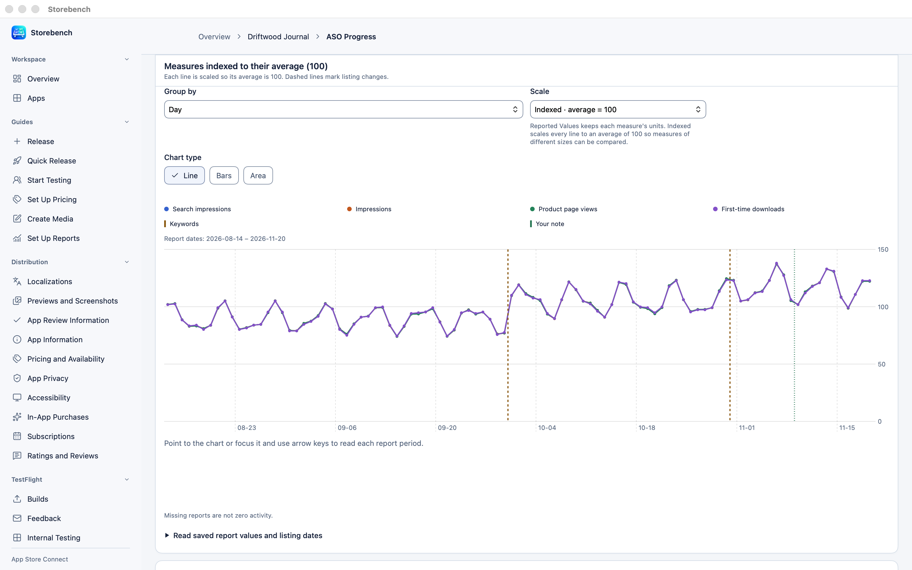

Storebench is a native Mac app for developers managing several apps in App Store Connect. Set country prices from one guide price, keep your listing history and see what changed after each update. Release apps step by step, bump an existing version, translate your listings and create screenshot cards by hand or with AI, all in one encrypted local workspace.

Edits stay on your Mac until you prepare a review and approve sending them to Apple. A local save, an upload and a public release are separate steps.

[See all screenshots](#screenshots).

## Set country prices without working through them one by one

Set one guide price and choose how the other countries follow it: **World Bank purchasing power (PPP)**, **Big Mac Index**, **currency conversion** or **Same for all**, such as 4.99 in every currency.

Want your own rules? Save **country percentages**, **your own index** or a mix of models as a reusable profile. You can also choose **Apple's comparable prices** or **enter country prices yourself**, including from CSV.

Compare country prices side by side before choosing. Storebench rounds to Apple's price points and shows the changes before you approve sending them.

[See the pricing choices and country preview](#pricing-models).

## Keep your listing history and see what happened after a change

You changed a subtitle or replaced some keywords. Which wording was there before, when was the new listing first seen, and did impressions, page views or downloads move afterwards?

Storebench saves each listing revision you import for each app, together with downloaded reports, in your encrypted workspace. Later syncs add new snapshots without replacing the earlier ones. You can go back to the saved text and screenshots, compare versions, and read the history on your Mac.

In **ASO Progress**, choose a language and the listing fields you want to compare. Overlay up to four report measures on the same graph: impressions, App Store product page views, Get taps, first-time downloads or purchases, including search-specific measures where available. Use the indexed scale to compare measures with different sizes, draw the graph as lines, bars or areas, and pick the dates with 7, 30 or 90 days, 6 months, 1 year, this year, all saved dates or your own range. Markers show where a changed released listing was first observed at a sync, colored by what changed: keywords, name or subtitle, screenshots or other text. Add your own dated notes, such as a campaign or a price change, and they appear on the same graph. Click a marker to open that version or note.

Select a change to read the old and new text and compare the same number of days before and after it. For example, compare seven days around a keyword update, then inspect the next update on the same timeline. This helps you decide what to try next from your own saved history.

The comparison shows observed changes, not proof that an ASO edit caused them. Other listing updates and your notes in the same window are identified, whichever language or field you are viewing. Missing reports stay missing, and the observed date is not a verified publication time. History builds from the listings and reports you import; text from before your first saved snapshot cannot be reconstructed.

[See the ASO timeline and before/after comparison](#aso-history).

## Follow a full release from setup to App Review

From the questions about your app to releasing it, **Release** keeps the work in one flow. App details, age rating and required declarations, text, screenshots, build, export compliance and App Review: go step by step, with the checks and editors together. See what's missing, fix it there and continue, without hunting through views and tabs.

App already out and you just need to bump the version? **Quick Release** shows the essentials: version, build and Add for Review, carrying over your existing listing. Finished steps stay collapsed. Expand **Text** to change **Description, Subtitle, Keywords and What's New**, then continue in the same flow. If the update needs more, open the full Release guide with the same work.

[See Release and Quick Release](#release-and-quick-release).

## Prepare screenshots without moving between tools

Add screenshots from files or Asset Library in **Release → Text and Screenshots**. Check the language and display size, drag screenshots into the order you want, and save the layout. Upload prepares a review of what will change at Apple.

Use **Create Media** to make your own App Store cards with layouts, headlines, fonts and colors, beside a live preview. Or add your screenshots to **Create AI Cards**, describe the look and message, and choose a service and model. Re-create a card with a new prompt until it feels right; earlier versions stay saved.

Translate the finished card set into more languages while keeping its layout and screenshots. Save the PNGs to **Asset Library**, ready to use in a release.

[See screenshot ordering and card creation](#screenshots-and-card-creation), or [see Asset Library](#asset-library).

## Requirements

Storebench runs on macOS 14 or later, on Apple silicon and Intel Macs. Connecting an app requires an App Store Connect API key with access to that app. Available actions depend on the account's permissions and the app's current state at Apple.

## Getting started

Choose **Use Keychain** or **Use Password** when Storebench first opens. Both options encrypt saved data and media. Password storage requires your Storebench password to unlock the workspace; keep it safe, because it cannot be recovered.

Connect your API key during setup or in **Settings → Apple accounts**. Choose the original `.p8` file and supply its Key ID if Storebench cannot read it from the filename. Team keys also need their Issuer ID. You can connect several accounts, refresh their app lists and reconnect a key without removing saved app history. **Skip for now** opens an empty workspace so you can connect later.

Use **Overview** or **Apps** to download app material and reports. The sidebar opens each app's editing, release, TestFlight and reporting sections. **Help** contains searchable guidance for setup, permissions and common problems.

## Releases and localizations

Prepare a version from existing app material, copy an earlier version or start with an empty local plan. Edit listing text across languages, select a build and check what is still needed before submitting the version.

**Localizations** keeps each language's text and character limits together. Pick one source language, select the languages you want and populate them in one go with **Apple Intelligence**, your **ChatGPT plan** or your own **OpenAI, Claude or Gemini model**. Review the drafts and sync when ready. Existing wording stays unless you choose to replace it; names and links are preserved.

You can also write the text yourself, reuse saved wording or start a language with Apple's on-device translation. Source comparisons stay beside the edits.

Local drafts and release plans remain separate from what Apple currently has. **History** preserves imported material and saved revisions; **Change journal** records before-and-after values and lets you add local notes. A detected change does not establish when it became public on the App Store.

[See language editing](#localizations).

## Screenshots, app previews and Asset Library

Add screenshots and app previews to a version and language, change their order and review the saved selection. Image editing supports cropping, rotation and resizing while retaining the original.

**Asset Library** keeps encrypted local originals and reads assets already at Apple. Processed assets can be reused across compatible placements. Uploads, placement changes and asset deletion each require an approved review.

**Create Cards** is the visual editor: add your screenshots, pick a layout and style the text beside the preview. Use system fonts, installed fonts or a font file of your own. Save finished cards to Asset Library or export PNGs.

**Create AI Cards** starts with your screenshots and a short brief. Choose the service and model, generate a set, then adjust any text, layout or color yourself. **Re-create Card** opens the brief and screenshot for another iteration, keeping earlier card sets. Translate the finished set for more languages while retaining the layout and originals.

Add creative directions, your own **Prompt Instructions**, notes for individual cards or an exact **Card Colors** palette. The original screenshot stays visible unless you allow cropping. **AI History** in Settings keeps the saved requests and responses so you can return to earlier work.

In **Settings → AI**, use Apple Intelligence on this Mac, connect your ChatGPT plan or add your own OpenAI, Claude or Gemini API key. Choose a model for each job without changing saved defaults. Apple Intelligence requires a compatible Mac with macOS 26 or later. ChatGPT uses your plan's permissions and limits; API connections use the provider's API billing. Selected text and screenshots go only to the service you choose. Credentials stay in protected storage and are excluded from backups.

## Pricing

Manage the app's download price separately from subscriptions and in-app purchases. Read current and scheduled prices, prepare changes by country or region, and compare proposed prices before sending them.

Price strategies include Apple's comparable prices, currency conversion, purchasing-power models, the Big Mac Index, saved profiles and manually entered country prices. Apple's comparable prices follow the base country or region you choose; any of Apple's countries or regions can be the base. Saved profiles are recipes that can mix two methods, adjust countries by percentage, keep prices within a lowest and highest price, and use your own index values.

Country prices, country percentages and your own index can be imported from CSV files that use Apple's three-letter territory codes. Prices use the columns of Storebench's own price export, so an exported file can be edited and read back. Copy CSV Format copies each format with example rows, and the pricing help describes every column. Importing only fills in the editor; nothing is saved or sent. Storebench matches proposed amounts to the product's available Apple price points and identifies missing data. Protected app prices are kept out of model and country-draft changes.

Shared profiles and local pricing drafts detect conflicting saves. Reading newer saved values leaves your edits in place until you explicitly choose which baseline to use. Price changes and offers go through the same approval process as other App Store Connect changes.

## App information, App Privacy and App Review

Edit supported app information, age-rating answers, accessibility declarations, availability, export compliance and App Review information. Storebench checks the selected app and the information required for each change.

**App Privacy answers** and **Tax Category** use a separate Apple ID sign-in because they are not available through the API-key connection. Sign-in asks for the Apple ID, password and any required two-factor code. Saving the password for a later sign-in is optional. **Sign Out** in the Apple ID form removes the saved Apple ID session.

## TestFlight

Keep beta testing with the app's release work. Read builds and processing states, handle export compliance, manage internal and external groups and testers, edit test information, and inspect feedback and metrics. **Start Testing** walks through the setup in order, including what is still needed before a build can reach testers.

Changes to TestFlight settings, group access, tester assignments and Beta App Review submissions are reviewed before being sent. Apple still controls build processing and beta review.

[See TestFlight builds and groups](#testflight-builds-and-groups).

## Reports and sync

Read **Sales and Trends**, **Analytics**, **Financial Reports** and **Ratings and Reviews**. Sales and Finance can use the API connection or a separately configured Reporter token. Reporter downloads use HTTPS directly.

Sync downloads data and keeps saved drafts. It shows incomplete sources separately so a partial download is not presented as a complete sync. Missing reports and unverified values remain unknown. An explicit, validated day without sales is recorded separately from a report Apple has not delivered.

Sales, Analytics and ASO views share the same date choices: 7, 30 or 90 days, 6 months, 1 year, this year, all saved dates or your own range. Sales analysis shows report coverage, original currencies, trends and country totals. Analytics and ASO views help compare reported activity with recorded changes while retaining coverage and source information. Generating Analytics reports at Apple requires an approved review. Financial downloads have a separate local review before replacing saved reports.

## Keyword ideas

Keep a local notebook of keyword ideas by language and territory, with evidence notes, filters and bulk changes. Preview selected ideas against a listing's current keywords and UTF-8 byte budget before applying them to the unsaved text. Notebook imports and exports support CSV and JSON.

## Reviewing changes at Apple

**App Store changes** shows the exact operations prepared for one account and app. Preparing a review does not send those operations. Approval applies once to that review, and Storebench reads Apple again to check that the reviewed state is still current.

A changed draft, changed Apple state or expired review requires a new review. If publishing is interrupted, some earlier operations may already have reached Apple. Storebench records the result and requires a new review instead of replaying the interrupted run.

[See the review before sending](#review-before-sending).

## Storage and backups

Saved metadata, drafts, revisions and reports live in an encrypted local SQLCipher database. Media files are encrypted separately. Credentials use the storage provider selected for the workspace: macOS Keychain or a password-encrypted credential file. Security settings also offer Mac authentication and protected Keychain access.

Use a private local disk for the workspace. A network share or file-synchronization folder is not supported for live workspace data. Saved material survives restarts; unsaved form edits still need to be saved.

Encrypted backups include saved workspace data and media and require a restore passphrase. Automatic backups use a folder you choose. Keep the passphrase separately from the backup and reconnect Apple credentials when restoring on another Mac. The workspace itself is not a backup.

CSV and JSON imports preview their local changes before saving. Exports can contain private app information and should be stored accordingly. Importing local material does not publish it to Apple.

## Settings and navigation

Settings cover accounts, reporting connections, storage protection, backups, appearance, editing, keyboard shortcuts and performance. The Performance setting controls cache budgets and how long background reads are reused. Screens show cached results before checking Apple again, sharing requests already in progress. Saved screen results can be restored from encrypted SQL after memory eviction, with decoding away from the interface thread.

Visible reads take priority over preparation in the background. Within the same priority, small metadata requests go before larger pages and downloads, with a bounded wait for older requests. Local history arrives before remote preparation starts. Manual refresh replaces affected reads; publishing approval always checks fresh information.

Unsaved editors ask you to save, discard or keep editing before leaving. Back and Forward retain navigation history. Keyboard shortcuts can be changed in Settings, and Command–Comma opens Settings.

## Build from source

Building requires Xcode or the Xcode Command Line Tools with Swift 6. Resolve the pinned SQLCipher dependency, then build the app and unsigned installer:

```bash
swift package resolve --package-path macos --disable-keychain --disable-netrc
scripts/package-mac.sh
```

The public packaging command builds a universal app with placeholder version metadata and ad-hoc signatures for local execution. The installer is unsigned. Packaging does not start, install or upload the app.

The app's screens are built from shared design components. [Design components](docs/design-components.md) describes how buttons, labels, button groups and status rows are sized and placed, so new screens look and behave like the rest of the app.

## Tests

Run tests through the isolated runner:

```bash
scripts/test-swift.sh unit
```

The runner uses synthetic data in a fresh owned workspace. Its macOS sandbox blocks networking, private home data and writes outside that run. Tests do not launch the app, access real Keychain entries or use real Apple accounts. The pinned dependency must already be available locally.

## License

Storebench is source-available. Personal and other non-commercial use is free. Business use requires an active subscription for each person who uses Storebench, available through the Mac App Store, or another commercial license from the licensor. Business use ends with the subscription. See [LICENSE](LICENSE).

## Screenshots

These screenshots show Storebench's native Mac interface with synthetic app data and example model names.

### Pricing models

One guide price, several ways to price the world. Choose PPP, Big Mac Index, currency conversion, Same for all, your own profiles, Apple's comparable prices or manual prices.

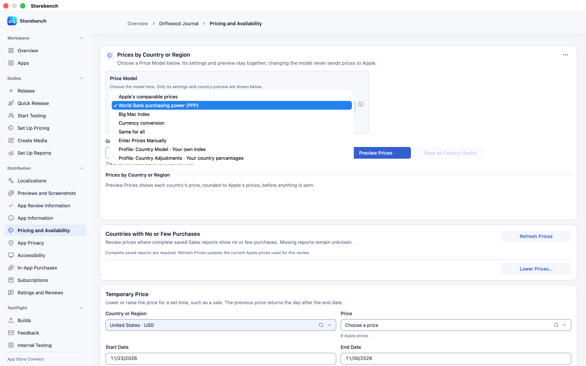

Preview the countries together, rounded to Apple's available price points.

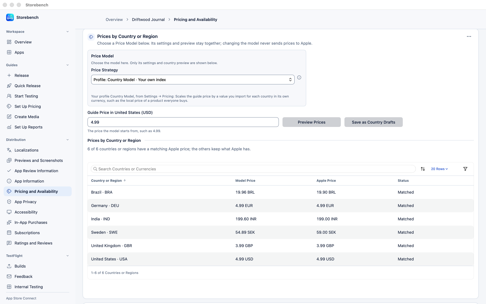

### ASO history

Follow listing changes on the report timeline, then compare the same number of days before and after an update.


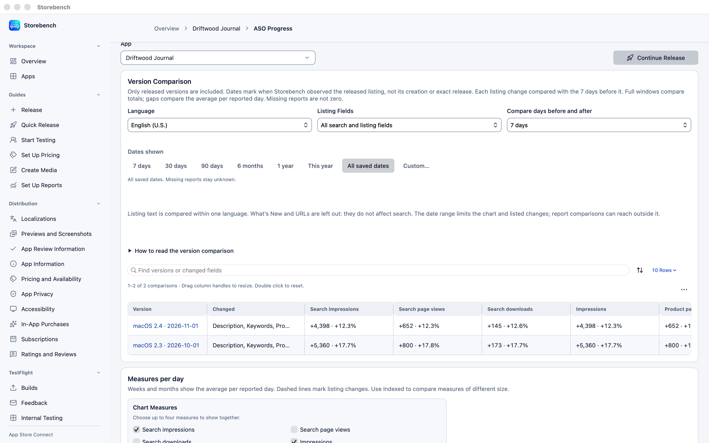

### Release and Quick Release

**Release** takes you from the questions about your app to App Review and release. Checks and editors stay together: fix what's missing and move to the next step.

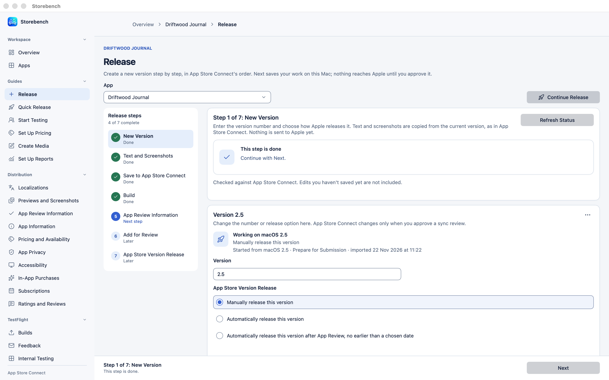

**Quick Release** keeps a version bump small. Carry over your listing, choose the version and build, then Add for Review. Completed steps stay out of the way.

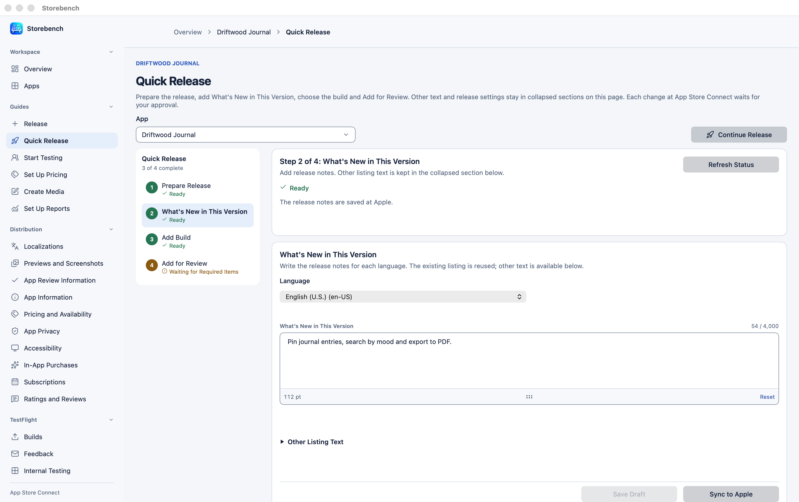

Need an ASO tweak? Expand Text for Description, Subtitle, Keywords and What's New, without leaving the flow.

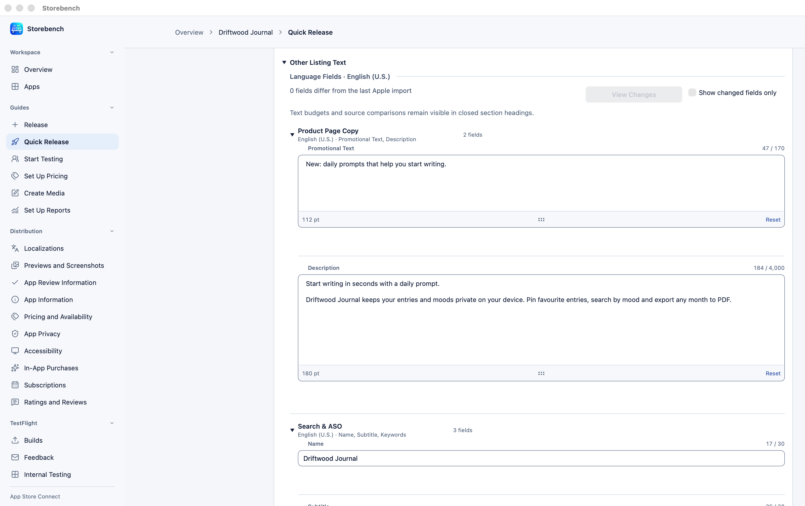

### TestFlight builds and groups

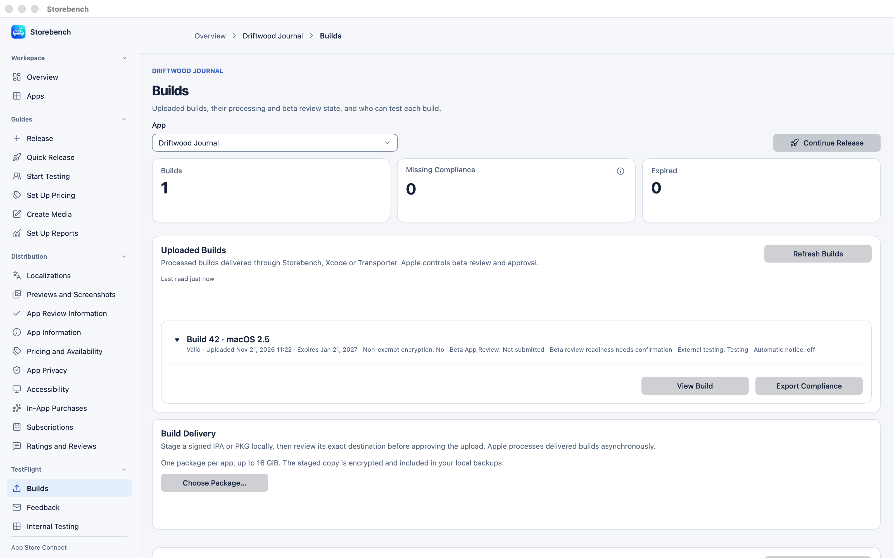

### Screenshots and card creation

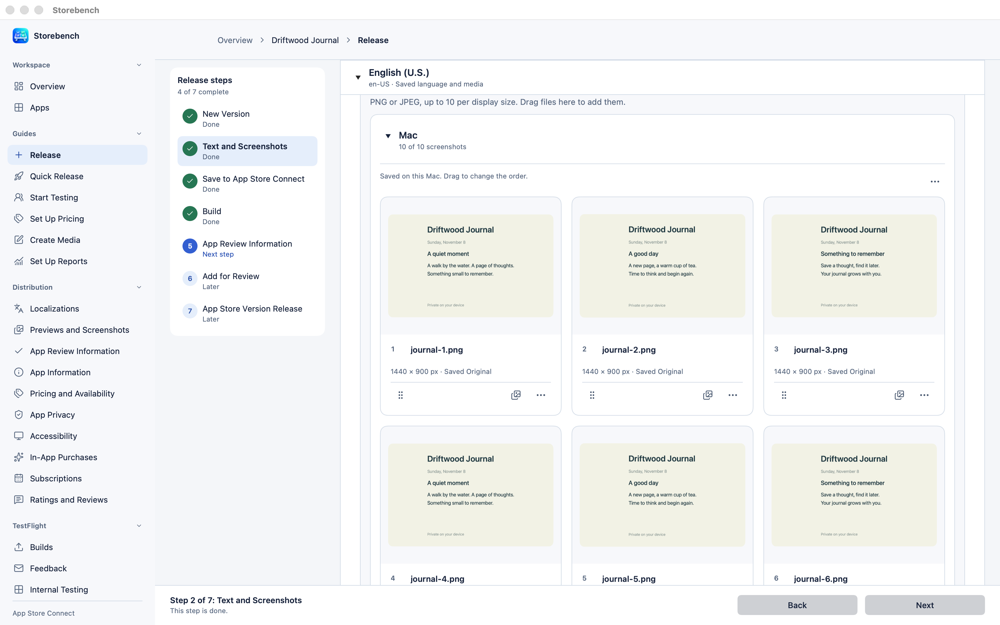

**Create Cards:** pick a layout, write the headline and style your card beside the preview.

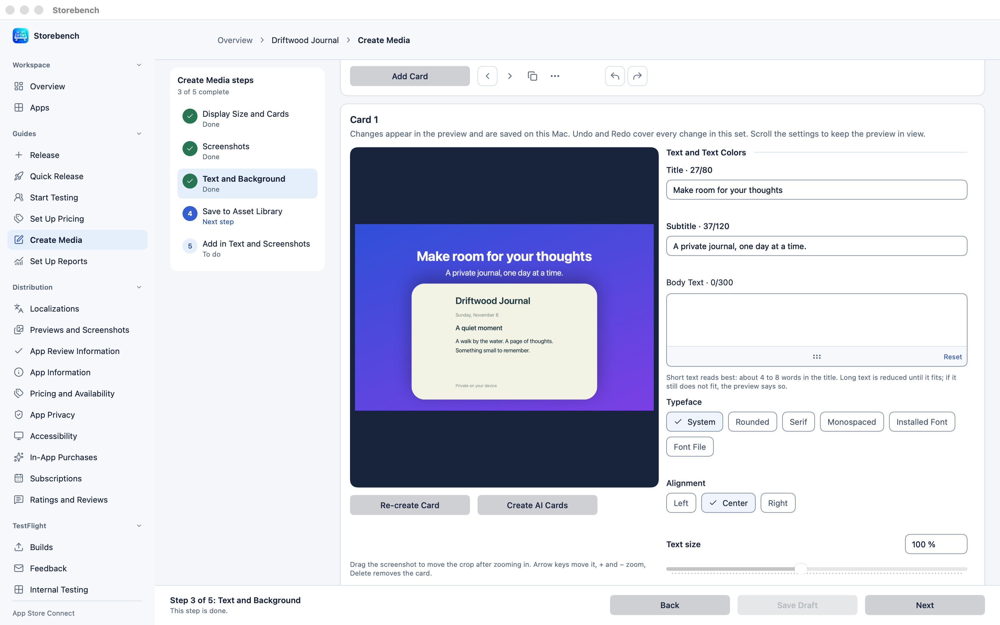

**Create AI Cards:** describe the look and message, then iterate with Re-create Card. Your screenshots and earlier versions stay saved.

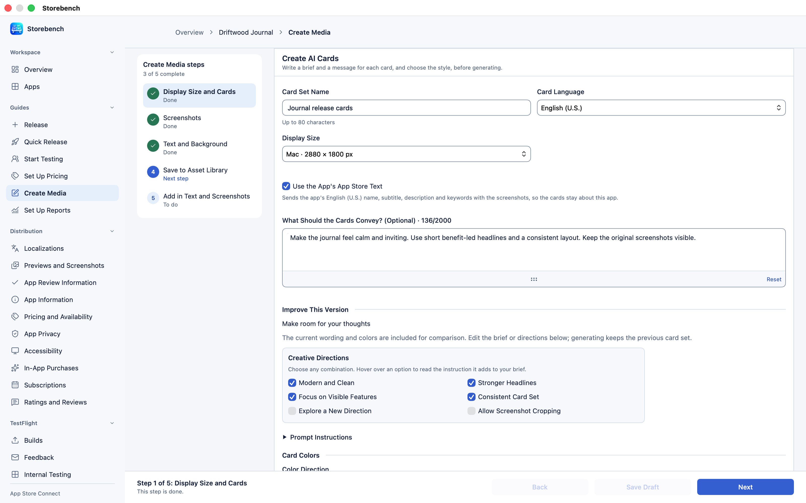

Choose a service and model for the job. Translate the finished set for more languages while keeping its design and screenshots.

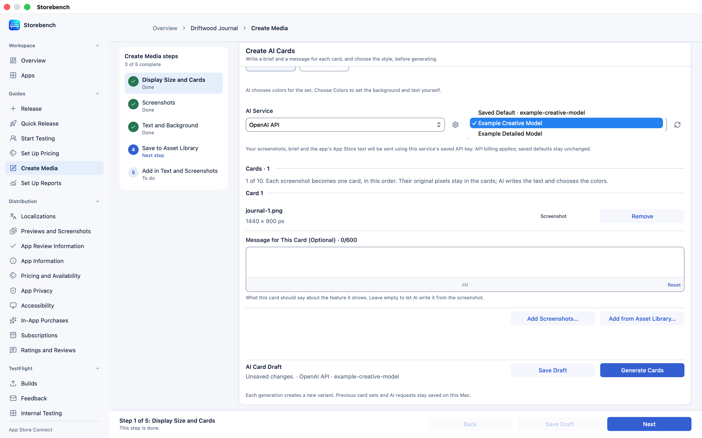

### Asset Library

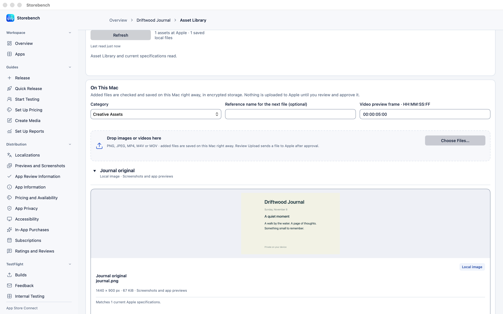

### Review before sending

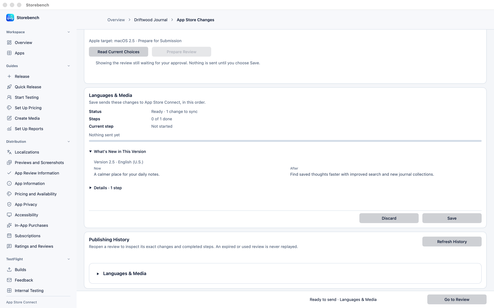

### Localizations

One source, several languages. Choose Apple Intelligence, your ChatGPT plan or a connected OpenAI, Claude or Gemini model, then populate the selected languages together. Review the drafts before syncing.

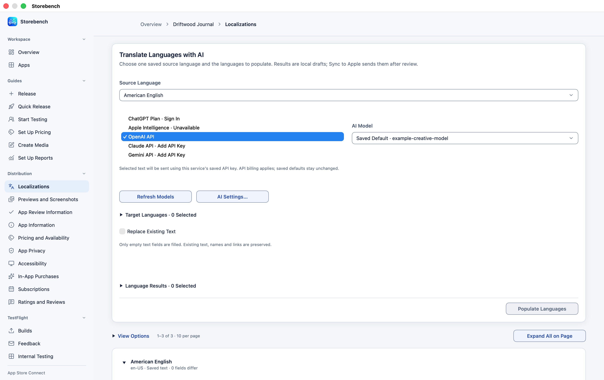

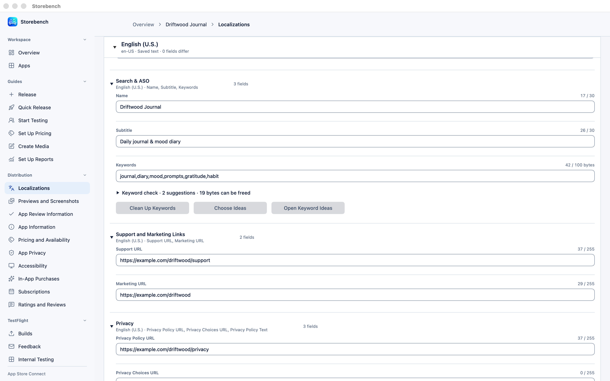

### Sales and Trends

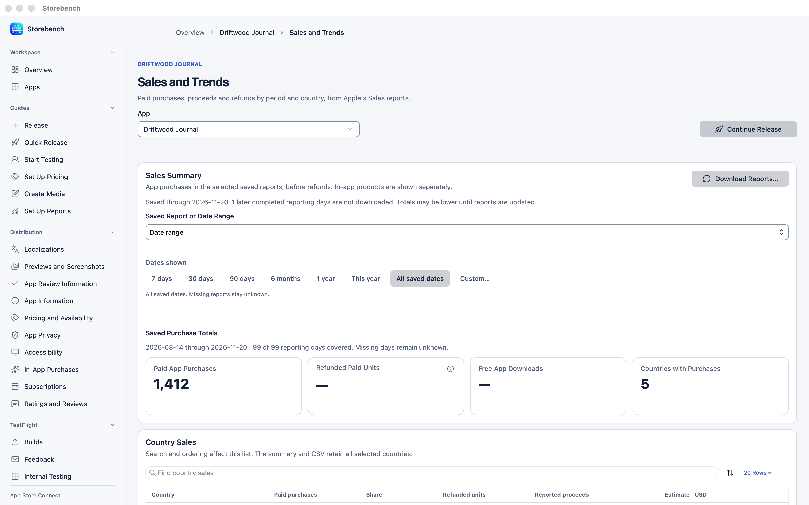
